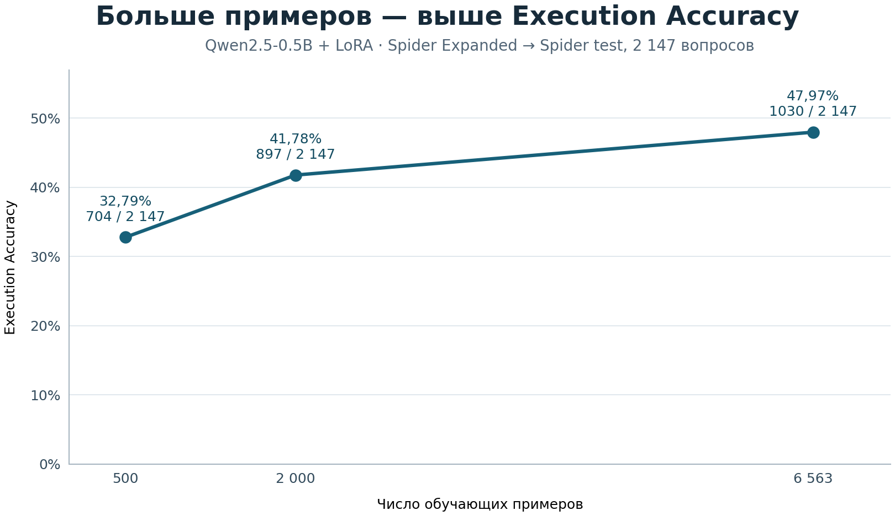

# Влияние объёма Spider Expanded на качество Text-to-SQL

## Постановка

Обучены три LoRA-адаптера для Qwen2.5-0.5B Base на 500, 2 000 и 6 563
примерах из `spider_expanded_restored.zip`. Для всех запусков использовались
две эпохи, seed 42, LoRA rank 16 и один набор из 300 примеров для валидации.
Подвыборки вложены друг в друга. Во всех трёх случаях модель начинала
дообучение с базовых весов.

## Аудит датасета

Между train, validation и Spider dev из архива не найдено общих `db_id`
и совпадающих троек «база, вопрос, SQL». В train обнаружено 8 повторных записей
при точном сравнении и 24 при сравнении без учёта регистра и пробелов.
Второе число включает первое. Для эксперимента использован опубликованный
архив с исходным составом записей.

`src/data.py` собирает original без `--include_others` и expanded с этим
флагом. Для этих запусков использовано готовое разбиение из
[опубликованного архива](https://github.com/Pavel-V418/BaseModel-vs-SFT/tree/dataset/spider-expanded-restored/datasets/spider-expanded-restored).

## Оценка

Все адаптеры оценены на одних и тех же 2 147 вопросах Spider 1.0 test
[оценщиком v3](https://github.com/Pavel-V418/BaseModel-vs-SFT/tree/1bf6018f71a58551ca6f66077c7a1839a68f1f88).
Режим zero-shot, greedy decoding, максимум 256 новых токенов.

| Примеров в train | Верных результатов SQL | Execution Accuracy |
|---:|---:|---:|
| 500 | 704 / 2 147 | 32,79% |
| 2 000 | 897 / 2 147 | 41,78% |
| 6 563 | 1 030 / 2 147 | 47,97% |

При увеличении выборки с 500 до 6 563 примеров Execution Accuracy выросла
на 15,18 п. п., или на 326 верных результатов. При фиксированных двух эпохах
вместе с объёмом данных росло число шагов обучения. Эксперимент проведён
с одним seed.

Полные метрики доступны в `comparison.csv` и `*_eval_metrics.json`.